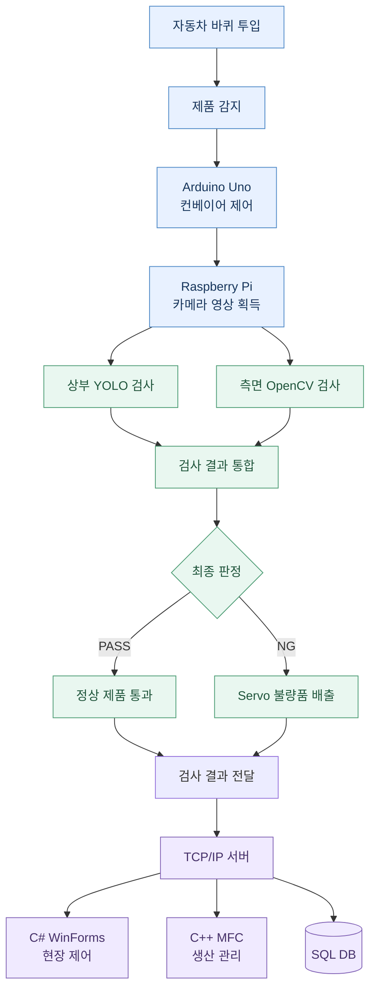
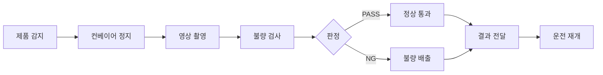

 <div align="center">

# SmartWheel Inspection System

### 자동차 바퀴 불량 검사 및 스마트팩토리 생산관리 시스템

**Computer Vision · Factory Automation · Production Management**


---

**자동차 바퀴의 품질 검사부터 불량품 분류, 설비 제어, 생산 데이터 관리까지 통합한 스마트팩토리 프로젝트**

</div>

## 📌 01. Project Overview

### 프로젝트 소개

SmartWheel Inspection System은 자동차 바퀴의 타이어와 휠 상태를 영상처리 기술로 검사하고, 검사 결과에 따라 제품을 분류하는 **자동 검사 생산라인 시스템**입니다.

Raspberry Pi에서 YOLO 및 OpenCV 기반 검사를 수행하고, Arduino Uno로 컨베이어를 제어합니다. C# WinForms는 현장 장비 제어를, C++ MFC는 생산 현황과 검사 이력 관리를 담당합니다.

| 항목 | 내용 |
|:---|:---|
| **프로젝트명** | SmartWheel Inspection System |
| **개발 기간** | 2026.10.16~10.27 |
| **개발 인원** | 5명 |
| **개발 형태** | 팀 프로젝트 |
| **검사 대상** | 타이어와 휠이 조립된 자동차 바퀴 |
| **핵심 기술** | YOLO, OpenCV, Arduino, Raspberry Pi, WinForms, MFC, TCP/IP, SQL DB |

### 핵심 목표

- **자동 품질 검사** — 타이어 종류 및 파손 여부 판별
- **생산라인 자동화** — 제품 감지, 컨베이어 제어 및 불량품 분류
- **실시간 모니터링** — 검사 결과 및 설비 상태 확인
- **생산 데이터 관리** — 검사 이력, 통계, 이벤트 로그 및 보고서 관리

---

## 🏗️ 02. System Architecture

### 전체 시스템 구성



### 구성 요소별 역할

| 구성 요소 | 담당 기능 |
|---|---|
| Arduino Uno | 컨베이어 모터 구동 및 정지 |
| Raspberry Pi 4B | 카메라 영상 처리 및 자동화 |
| YOLO | 상부 영상 검사 |
| OpenCV | 측면 타이어 무늬 및 파손 검사 |
| C# WinForms | 현장 작업자용 장비 제어 |
| C++ MFC | 관리자용 생산관리 시스템 |
| TCP/IP | 프로그램 간 데이터 송수신 |
| SQL DB | 검사 결과 및 생산 정보 저장 |

---

## 🛠️ 03. Tech Stack

### Software

| 분야 | 기술 |
|---|---|
| 영상처리 | Python, OpenCV |
| 객체 검출 | YOLO |
| 현장 프로그램 | C#, WinForms |
| 관리자 프로그램 | C++, MFC |
| 통신 | TCP/IP |
| 데이터베이스 | SQL DB |

### Hardware

| 장비 | 역할 |
|---|---|
| Raspberry Pi 4B | 영상 검사 및 자동화 제어 |
| Arduino Uno | 컨베이어 제어 |
| USB Global Shutter Camera | 검사 영상 촬영 |
| 컨베이어 및 모터 드라이버 | 제품 이송 |
| 제품 감지 센서 | 제품 감지 |
| Servo Motor | 불량품 배출 |
| LED / 부저 | 장비 상태 알림 |

### Raspberry Pi 개발 환경

| 항목 | 버전 |
|---|---|
| OS | Debian GNU/Linux 13 (trixie) |
| Python | 3.13.5 |
| OpenCV | 4.10.0 |
| NumPy | 2.2.4 |

---

## 🔍 04. Inspection Logic

### 검사 대상 및 판정 기준

정상 A형 타이어와 정상 휠이 조립된 경우에만 최종 PASS로 판정합니다.

| 구분 | 타이어 | 휠 | 판정 |
|:---:|---|---|:---:|
| 정상 | 정상 A형 | 정상 | **PASS** |
| 불량 1 | 정상 A형 | 파손 | **NG** |
| 불량 2 | 파손 | 정상 | **NG** |
| 불량 3 | 파손 | 파손 | **NG** |
| 불량 4 | 정상 B형 | 정상 | **NG** |

### 검사 단계

<details>
<summary><b>STEP 01 — 상부 YOLO 검사</b></summary>

상부 카메라 영상을 기반으로 제품을 검사합니다.

- 객체 검출 및 상부 검사
- 휠 상태에 대한 검사 결과 생성
- 측면 검사 결과와 연계

</details>

<details>
<summary><b>STEP 02 — 측면 OpenCV 검사</b></summary>

측면 카메라 영상에서 타이어 종류와 파손 여부를 확인합니다.

**주요 처리 과정**

1. 카메라 영상 획득
2. 배경 차분 및 제품 영역 검출
3. 밝기와 영상 상태 확인
4. A형/B형 기준 무늬 비교
5. 타이어 파손 검사
6. 검사 결과 생성 및 저장

측면 카메라는 한 각도만 사용하며, 카메라에서 보이지 않는 반대쪽 파손은 검사 범위에서 제외합니다.

</details>

<details>
<summary><b>STEP 03 — 최종 검사 결과 통합</b></summary>

상부와 측면 검사 결과를 통합하여 제품의 최종 정상 및 불량 여부를 판단합니다.

측면 검사 결과인 `SIDE_PASS`는 측면 검사 통과를 의미하며, 휠 상태까지 포함한 최종 PASS와 구분합니다.

</details>

### 측면 검사 상태값

| 상태 | 의미 |
|---|---|
| `SIDE_PASS` | 측면 검사 통과 |
| `NG_WRONG_TIRE` | 잘못된 타이어 종류 |
| `NG_DAMAGE` | 타이어 파손 |
| `RECHECK` 계열 | 영상 또는 검사 상태 재확인 필요 |

---

## ⚙️ 05. Main Features

### 5.1 생산라인 자동화



제품 감지부터 검사, 정상 제품 통과 또는 불량품 배출, 결과 전달까지 연결하는 자동화 흐름입니다.

### 5.2 C# WinForms — 현장 제어

**주요 기능**

- AUTO / MANUAL 운전 모드
- START / STOP / RESET
- 컨베이어 제어
- Servo 수동 제어
- 장비 및 검사 상태 표시
- 운전 상태에 따른 버튼 잠금

자동 처리 도중 STOP 요청이 발생하면 후속 동작과 자동 재시작을 취소하도록 제어 로직을 구성했습니다.

### 5.3 C++ MFC — 생산관리

| 모듈 | 주요 기능 |
|:---:|---|
| **M1** | 생산 대시보드 |
| **M2** | 검사 이력 및 NG 이미지 조회 |
| **M3** | 설비 상태 및 이벤트 로그 |
| **M4** | 생산 통계 및 그래프 |
| **M5** | 실시간 채팅 및 인수인계 |
| **M6** | 일일 생산 보고서 |

**M1. 생산 대시보드**

총 검사 수, 정상 수, 불량 수, 불량률, 최근 검사 결과 및 설비 상태를 표시합니다.

**M3. 설비 모니터링**

설비 상태와 이벤트 로그를 표시하고, 설비 및 이벤트 등급에 따른 필터링과 상세보기를 지원합니다.

---

## 👩‍💻 06. My Contributions

### 조시현 — 주요 개발 담당

| 구분 | 개발 내용 |
|---|---|
| **H1** | Arduino Uno 기반 컨베이어 제어 공동 개발 |
| **S1** | 측면 OpenCV 타이어 무늬 구분 및 파손 검사 |
| **S2** | Raspberry Pi 자동화 공동 개발 |
| **S3** | WinForms 장비 제어 공동 개발 |
| **M1** | MFC 생산 대시보드 |
| **M3** | MFC 설비 상태 및 이벤트 로그 |
| **M4** | 생산 통계 및 그래프 공동 개발 |

### 주요 구현 경험

**01. OpenCV 기반 측면 검사**

- A형/B형 타이어 무늬 비교
- 제품 영역 검출 및 배경 차분
- 파손 검사 로직 개발
- 이동 중 검사 및 중복 저장 방지 시험

**02. WinForms 장비 제어**

- 자동/수동 모드 전환
- START/STOP/RESET 상태 제어
- Servo 수동 조작
- 자동 처리 중 STOP 취소 로직

**03. MFC 생산관리**

- 생산 실적 및 불량률 표시
- 최근 검사 결과 목록 및 그래프
- 설비 상태 및 이벤트 로그
- 등급별 색상, 필터 및 상세보기

---

## 👥 07. Team Collaboration

5명의 팀원이 하드웨어, 영상처리, 통신, Windows 응용프로그램 및 데이터베이스 기능을 분담했습니다.

| 담당자 | 주요 역할 |
|---|---|
| 김초아 | 컨베이어, 자동화, WinForms 제어, SQL DB, 통계, 보고서 |
| **조시현** | 컨베이어, OpenCV, 자동화, WinForms 제어, MFC 대시보드·설비 로그·통계 |
| 유동호 | 제품 감지, LED/부저, WinForms 모니터링, TCP/IP, 채팅 |
| 노종헌 | 카메라, Servo, OpenCV, TCP/IP, MFC 검사 이력 |
| 노원종 | 제품 감지, LED/부저, WinForms 모니터링, TCP/IP, 채팅 |

공동 담당 기능은 팀원 간 협업으로 개발했습니다.

---

## 🧪 08. Development & Testing

개발 과정에서 확인한 기능과 시험 결과입니다.

| 검증 항목 | 확인 내용 |
|---|---|
| Arduino Uno | 컨베이어 단독 구동 및 정지 |
| 측면 OpenCV | A형/B형 구분 및 이동 중 검사 시험 |
| 자동 저장 | 동일 제품의 중복 저장 방지 시험 |
| WinForms | 모드 전환, 시작, 정지, 초기화, Servo 제어 |
| WinForms 자동화 | 가상 제품 감지부터 분류 및 STOP 취소 시뮬레이션 |
| MFC M1 | 샘플 생산 실적, 최근 검사 목록 및 그래프 |
| MFC M3 | 가상 설비 상태, 이벤트 로그, 필터 및 상세보기 |
| 통합 프로그램 | 실제 통합 실행 확인 |
| B형 타이어 | 실제 투입 시 최종 NG 판정 확인 |

> 개별 기능의 시뮬레이션과 실제 하드웨어 시험은 서로 구분합니다. 위 내용은 확인된 시험 결과이며, 모든 검사 조합에 대한 정확도 검증을 의미하지는 않습니다.

---

## 🎬 09. Demo

### SmartWheel — 자동차 바퀴 불량 검사 및 생산라인 자동화 시연

**시연 영상 추가 예정**

영상에는 제품 투입, 검사, 판정, 불량품 분류 및 현장·관리자 프로그램 동작을 포함할 예정입니다.

---

## 📁 10. Project Structure

```text
SmartWheel-Inspection-System/
│
├── 하드웨어 코드/
│   ├── Arduino 관련 소스
│   └── Raspberry Pi 관련 소스
│
├── 소프트웨어 코드/
│   └── 소스코드/
│       ├── MFC/
│       ├── RaspberryPi/
│       ├── TireProductionServer/
│       └── WinForms 관련 소스
│
└── README.md
```

실제 실행을 위해서는 장치별 설정, 네트워크 연결 및 검사 기준 영상이 필요합니다.

하드웨어 연결 환경과 설정값에 따라 실행 방법이 달라질 수 있으며, 인증 정보 및 장치별 비공개 설정은 저장소에 포함하지 않습니다.

---

## 💡 11. What I Learned

### 영상처리와 실제 환경의 차이

실제 카메라 영상은 배경, 조명, 촬영 각도에 따라 달라지기 때문에 검사 알고리즘뿐 아니라 촬영 환경과 기준 영상의 안정성이 중요하다는 점을 경험했습니다.

### 상태 기반 장비 제어

WinForms에서 운전 모드와 장비 상태에 따라 사용자 입력을 제한하고, 자동 처리 중 STOP 요청을 처리하는 상태 제어 로직을 구현했습니다.

### 생산 데이터 시각화

MFC를 활용하여 생산 실적, 검사 결과, 설비 이벤트를 작업자와 관리자가 이해하기 쉬운 형태로 표현했습니다.

### 시스템 통합과 협업

Arduino, Raspberry Pi, Windows 응용프로그램 및 서버를 하나의 생산라인 시스템으로 연동하는 과정에서 프로그램 간 역할 분리와 통신 인터페이스의 중요성을 경험했습니다.

---

<div align="center">

### SmartWheel Inspection System

**Computer Vision × Factory Automation × Production Management**

*5-Person Team Project · October 2026*

</div>
